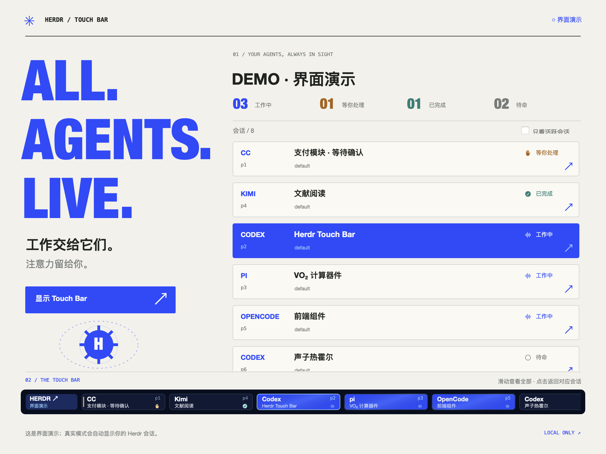

# Herdr Touch Bar

让所有 Herdr agent 的工作状态一直留在 MacBook Pro 的 Touch Bar 上。

原生 Swift / AppKit 应用，直接读取 Herdr 本地 Unix socket。无需 Pock、MTMR、BetterTouchTool，也无需为每个 agent 安装 hook。



## 功能

- CC / Claude Code、Codex、pi、Kimi Code、OpenCode，以及 Herdr 能识别的其他 agent；没有 provider 白名单。
- 按 **Herdr session socket + pane ID** 区分会话，同时开多个 Codex 或 CC 也不会互相覆盖。
- 显示 `blocked / done / working / idle / unknown`，优先排列等你处理和后台完成的任务。
- 原生全局 Touch Bar：切换终端或去其他应用，状态继续显示；保留系统 Control Strip。
- 点击会话调用 Herdr `pane.focus`，再激活 Herdr 所在终端。默认 iTerm2，可从菜单选择 Ghostty / Terminal。
- 横向滚动、隐藏待命会话、菜单栏计数、桌面面板；关闭桌面窗口后仍继续运行。
- 钴蓝色工作按钮有流动光带，桌面有慢速轨道动画；遵循系统“减少动态效果”。
- 每秒刷新；断线保留最后状态但明确置灰，禁止点击过期会话。不会用长时间无事件来推测任务完成。
- 所有数据来自本机 Herdr 元数据，不读取会话正文、密钥或账号信息，不启动网络服务。

## 安装与使用

```sh
git clone https://github.com/APhysickui/herdr-touchbar.git
cd herdr-touchbar
make install
```

安装后的应用位于 `~/Applications/Herdr Touch Bar.app`。双击应用可重新打开状态面板。

打开后自动显示 Touch Bar。左侧 **HERDR ↗** 打开桌面面板；菜单栏提供“显示 / 收起 Touch Bar”和退出。
系统的 × 可临时收起 Touch Bar，需要时从菜单栏重新显示。睡眠唤醒后会重新展示；如果希望持续收起，请使用菜单中的“收起 Touch Bar”。

首次运行会打开面板，之后仅在菜单栏常驻。需要登录自动启动时，把应用加入 macOS「登录项」；安装脚本不会修改登录项或 agent 配置。

## 构建与开发

要求 macOS 13+、Touch Bar 硬件、运行中的 Herdr，以及 Swift 6 / Xcode Command Line Tools。当前验证环境：macOS 27.0.1、arm64、Herdr 0.8.2 / protocol 20。

```sh
make check      # 11 项独立检查 + Release 构建（无需 XCTest）
make build      # 本地 ad-hoc 签名的 .app，输出到 dist/
make run        # 打开项目中的 .app
make install    # 安装到 ~/Applications 并启动
make preview    # 输出演示界面截图
```

```sh
"dist/Herdr Touch Bar.app/Contents/MacOS/HerdrTouchBar" --diagnose
"dist/Herdr Touch Bar.app/Contents/MacOS/HerdrTouchBar" --render-live /tmp/herdr-live.png
"dist/Herdr Touch Bar.app/Contents/MacOS/HerdrTouchBar" --stress-render
```

`--demo` 仅用于界面演示，不能切换真实 pane。`--render` 生成演示截图，`--render-live` 读取真实会话后生成截图。

默认发现 `~/.config/herdr` 下的 `herdr.sock`（包括子目录中的命名会话）。自定义配置路径可指定：

```sh
HERDR_TOUCHBAR_SOCKET=/path/to/herdr.sock \
  "dist/Herdr Touch Bar.app/Contents/MacOS/HerdrTouchBar"
```

## 状态含义与限制

| Herdr 状态 | 界面文字 | 含义 |
|---|---|---|
| working | 工作中 | Herdr 认为 agent 正在运行 |
| blocked | 等你处理 | Herdr 识别到批准或提问界面 |
| done | 已完成 | 后台任务已结束且尚未被查看；切回后 Herdr 会改为 idle |
| idle | 待命 | 可以接受输入 |
| unknown | 状态未知 | agent 存在，但 Herdr 不能可靠判断当前状态 |

状态精度取决于 Herdr；目前没有把“工作中”细分成思考、编辑、测试等工具级活动。普通 shell 不会被冒充为 agent；Herdr 尚未识别的新 agent 需要先在 Herdr 中配置检测 / integration。

全局显示使用运行时检测的 macOS 私有 Touch Bar API，未来系统升级可能改变行为。没有这些 API 的系统仍可以使用桌面面板。切换到终端后定位的是对应 Herdr pane；如果同一个终端开着多个独立 Herdr 客户端窗口，还需人工选择窗口，当前版本不操作终端的窗口或 tab。

## 项目结构

- `Sources/HerdrCore`：数据模型、排序、Unix socket 请求与发现。
- `Sources/HerdrTouchBar`：状态采集、Touch Bar、桌面界面与动画。
- `Sources/TouchBarBridge`：运行时解析全局 Touch Bar API。
- `Tests/HerdrCoreChecks`：不依赖 XCTest 的协议与模型测试。
- `scripts`：构建、安装和应用图标生成。

蓝白排版参考 [DPoker](https://aphysickui.github.io/DPoker/)，图形与代码独立绘制；全局 Touch Bar API 的可用性调查参考 [Pock](https://github.com/pock/pock) 和 [Agent Touch Bar](https://github.com/VdustR/agent-touchbar) 的公开实现。
